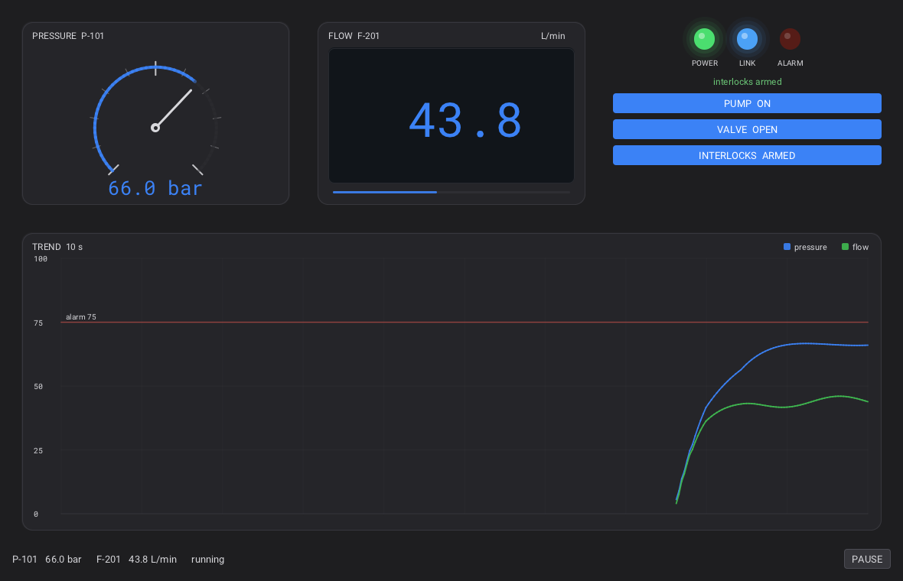

# Instrument panel

A process-control dashboard written three times — C++, Rust and Python — from
the same design: an analog gauge, a digital meter, indicator LEDs, push-button
switches and a real-time strip chart, all driven by a small simulated process.



This is a starter for SCADA-style / HMI screens: copy it, replace the simulation
with your data source, and the widgets stay.

---

## What it demonstrates

| Piece | How it is done |
|---|---|
| **Analog gauge** | `R_WIDGET_CUSTOM` + `Rcustom_set_paint_callback`: ticks, a 270° arc, a needle, a coloured track — all with `Rdraw_line` / `Rdraw_circle` |
| **Digital meter** | the same, with `Rfont_get_monospace()` and a recessed bezel |
| **LEDs** | translucent glow rings + a domed body, state in one `bool` |
| **Push buttons** | `Rbutton_create` + a style swap (`R_BUTTON_PRIMARY`) and a text swap |
| **Strip chart** | a ring buffer of 300 samples drawn as two polylines, with grid, Y labels, legend and an alarm threshold |
| **Layout** | boxes and slots, exactly as in the tutorials |
| **Theme** | every colour comes from `Rwidget_get_color(widget, role)`, so the panel follows the theme (try `R_THEME_LIGHT`) |
| **Live data** | `Rset_frame_callback` advances the simulation and requests a redraw each frame |

The simulated plant is deliberately simple: the pump charges a pressure vessel
(first-order lag), the valve lets flow through, and the interlocks trip the ALARM
lamp above 75 bar. Replace `simulate()` with a Modbus/OPC-UA/MQTT read and
nothing else changes.

---

## The files

```
InstrumentPanel/
├── cpp/      main.cpp, CMakeLists.txt      the reference implementation
├── rust/     src/main.rs, Cargo.toml       the same panel with raven-gui
└── python/   panel.py                      the same panel with the ctypes binding
```

The three files follow the same structure, in the same order:

1. the process state and its simulation;
2. four paint callbacks (meter, digital, LED, chart);
3. the UI construction;
4. the frame callback;
5. `--test` / `--capture` / normal run.

Read one and the others follow.

---

## Build and run

Every version needs the Raven **shared** library:

```bash
cmake -S Raven -B Raven/build -DCMAKE_BUILD_TYPE=Release -DRAVEN_BUILD_SHARED=ON
cmake --build Raven/build -j"$(nproc)"
```

### C++ (needs `raven-dev` installed, or `-DCMAKE_PREFIX_PATH=<Raven build>`)

```bash
cd cpp
cmake -S . -B build
cmake --build build
./build/instrument_panel
./build/instrument_panel --test
./build/instrument_panel --capture panel.ppm
```

### Rust

```bash
cd rust
cargo run --release
cargo run --release -- --test
cargo run --release -- --capture panel.ppm
```

No environment variables: `rust/.cargo/config.toml` links against the
repository's `build/` and records it as an rpath (build it once as above). With
the installed `raven-dev` instead: `RAVEN_STATIC=1 RAVEN_LIB_DIR=/usr/lib cargo run --release`.

### Python

```bash
cd python
export PYTHONPATH=/path/to/Raven/bindings/python:$PYTHONPATH
export RAVEN_LIBRARY=/path/to/Raven/build/libraven.so
python3 panel.py
python3 panel.py --test
python3 panel.py --capture panel.ppm
```

`--capture` writes a binary PPM (`P6`) of the last frame; any image viewer or
`convert panel.ppm panel.png` opens it.

---

## What `--test` checks

No window and no GPU: Raven starts with the null backend, and the program
checks the panel the way the tutorial steps do.

```
instrument panel: simulated 5.0 s, 106 samples, 1 meter paints, 1 chart paints
PASS
```

* every custom widget painted (the callbacks ran);
* the pump raises the pressure above its resting value;
* the valve lets the flow through;
* the chart collected samples;
* the interlock trips the alarm lamp above 75 bar;
* clicking the pump button toggles the switch;
* a paused simulation does not advance.

The paint counters are the interesting part: they prove that the custom-drawing
path runs even without a GPU, which is what makes a GUI of this kind testable.

---

## Where to go next

| Idea | How |
|---|---|
| A knob | another custom widget: drag → `angle → value` in a gesture callback |
| More meters | the same callback, parameterised by min/max/unit/high-alarm |
| A second chart | a second ring buffer, or a `struct Series` array drawn in one loop |
| Alarm log | append to a `std::vector` / `Vec` / `list`, draw the last N in a `ScrollBox` |
| Real data | replace `simulate()`; keep `PANEL.pressure` / `PANEL.flow` as the interface |
| A settings panel | `<Slider>`, `<CheckBox>`, `<SpinBox>` in a `Border` beside the chart |
| Recorded trends | write samples to CSV in the frame callback, one row per second |

The drawing primitives are in `include/raven/raven_draw.h`; the colors and
metrics the theme exposes are in `include/raven/raven_style.h`.
